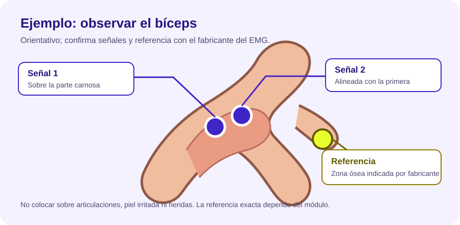
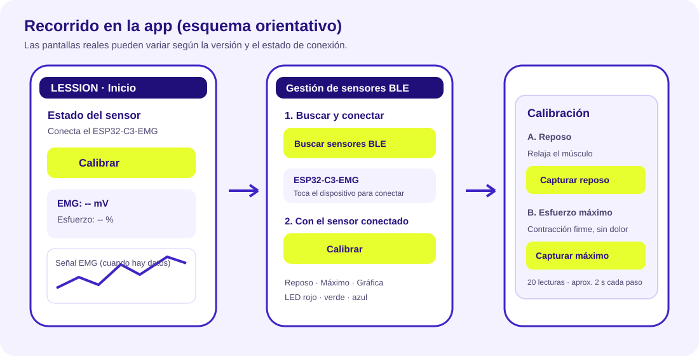

# Manual sencillo de Lession

Esta guía explica cómo conectar la banda, ver la señal y calibrar el módulo EMG. La
interfaz puede cambiar ligeramente entre versiones.

> **Estado del prototipo:** la lectura EMG del firmware está deshabilitada hasta verificar
> que la salida SIG sea segura para el pin A0 del ESP32-C3. La calibración física no estará
> disponible hasta que esa revisión eléctrica se complete y el módulo transmita lecturas.
> No conectes SIG directamente a A0 mientras no se confirme que permanece entre 0 y 3,3 V
> respecto de GND.

## 1. Antes de empezar

- Usa electrodos adhesivos en buen estado, sobre piel limpia y seca.
- Coloca la banda y los electrodos con el circuito apagado. Conecta la alimentación solo
  después de revisar el cableado.
- Comprueba que la ESP32, el sensor y la batería estén firmes y aislados; evita que los
  contactos de las baterías puedan tocarse entre sí o con la piel.
- No uses el prototipo si hay cables pelados, piezas calientes, batería hinchada o conexiones
  flojas. Detén la prueba si sientes irritación, molestia o dolor.
- No conectes el circuito a un cargador, puerto USB ni a otro equipo alimentado desde la red
  mientras los electrodos estén puestos.

La alimentación simétrica informada para el EMG es **+4 V, 0 V y −4 V**. Dos pilas 18650
en serie pueden superar 4 V cada una cuando están cargadas. No cambies el cableado de
alimentación ni unas las masas sin que una persona responsable del montaje revise el
esquema eléctrico.

## 2. Dónde colocar los electrodos

El siguiente dibujo es **orientativo para observar el bíceps**; no sustituye las
instrucciones del fabricante ni indica una colocación clínica. El músculo debe ser el que
realmente quieren observar. Sigue las marcas y el diagrama del módulo para identificar
electrodos de señal y referencia.

1. Identifica en el módulo qué electrodos corresponden a la señal del músculo y cuál es la
   referencia. No los intercambies por el dibujo.
2. Para observar el bíceps, coloca los electrodos de señal sobre la parte carnosa del
   músculo, en línea con el brazo y separados entre sí. Evita colocarlos sobre el codo o
   sobre una articulación.
3. Coloca la referencia donde indique el fabricante, normalmente sobre una zona ósea
   cercana. No la conectes a un pin eléctrico por intuición.
4. Si cambias de músculo, brazo, posición de la banda o ubicación de los electrodos, repite
   la calibración. Anota qué músculo y lado se midieron.

## 3. Conectar la app

1. Enciende el prototipo y abre Lession en el teléfono.
2. En **Inicio**, toca **Calibrar** para ir a la gestión de sensores.
3. Toca **Buscar Sensores BLE (ESP32-C3-EMG)** y concede los permisos Bluetooth que solicite
   Android.
4. Elige **ESP32-C3-EMG** en la lista. Espera a que la app confirme la conexión y empiece a
   recibir lecturas.
5. En Inicio o en la pantalla BLE, observa si aparecen valores EMG. Si siguen apareciendo
   guiones o dice que espera una muestra, no inicies la calibración: el sensor todavía no
   está enviando datos válidos.

La simulación es únicamente una demostración de la app; no representa una medición del
cuerpo.

## 4. Calibrar reposo y esfuerzo

La calibración es individual para **el músculo, lado, colocación y persona** de la prueba.
Guarda dos referencias:

1. En la pantalla BLE, toca **Calibrar**.
2. Para **reposo**, deja el músculo relajado, sin apretarlo ni moverlo, y toca **Capturar
   reposo**. La app promedia 20 lecturas válidas, aproximadamente 2 segundos.
3. Cuando lo indique la app, acomódate y prepara una contracción controlada.
4. Para **esfuerzo máximo**, contrae el músculo observado de forma firme y breve, sin dolor,
   y toca **Capturar máximo**. Se promedian otras 20 lecturas, aproximadamente 2 segundos.
5. La app guarda las referencias solo si el valor de máximo es mayor que el de reposo.

No son 20 contracciones: son 20 lecturas consecutivas en cada captura. Si no llegan
suficientes lecturas, la conexión se interrumpe o máximo no supera reposo, la app muestra
un error y permite reintentar.

### Cómo leer el porcentaje

La app compara la lectura actual con las dos referencias:

`esfuerzo relativo = (lectura actual − reposo) / (máximo − reposo) × 100`

Por ejemplo, con reposo de 100 mV y máximo de 500 mV, una lectura de 300 mV equivale al
50 % del intervalo medido durante esa calibración. El valor se limita visualmente a 0–100 %.
Al alcanzar o superar la referencia de máximo, la app emite una alerta para que el usuario
reduzca la intensidad o descanse.

**Ese porcentaje no mide fuerza muscular ni diagnostica fatiga o riesgo de lesión.** Es una
comparación de la señal con referencias de esa sesión. El resultado puede variar con la
posición, el contacto de los electrodos, el movimiento y el ruido eléctrico.

## 5. LEDs y botones

- **Rojo / Verde / Azul:** enciende o apaga cada canal del LED RGB conectado al dispositivo.
- **Encender todos / Apagar LEDs:** cambia los tres canales juntos.
- **Leer EMG:** solicita una lectura al dispositivo, si el firmware tiene habilitada la
  medición.
- **Reset:** borra las muestras y la gráfica de la sesión actual; conserva la calibración.
- **Desconectar Sensor:** termina la conexión Bluetooth.

## 6. Al terminar

Relaja el músculo, detén la prueba y apaga el circuito antes de retirar electrodos o
desconectar cables. Retira los adhesivos despacio y detén su uso si irritan la piel. No uses
la app ni el prototipo para decidir tratamientos, diagnosticar lesiones o sustituir la
orientación de un profesional.

## Datos técnicos para quien acompaña la prueba

- ESP32-C3 SuperMini: señal declarada en A0/GPIO0; RGB en GPIO8 (rojo), GPIO9 (verde) y
  GPIO10 (azul).
- BLE: nombre `ESP32-C3-EMG`.
- El sketch suministrado mantiene la lectura ADC deshabilitada hasta confirmar
  eléctricamente el rango de SIG y la referencia de masa. No habilitarla solo porque la placa
  haya sobrevivido a pruebas anteriores.
- El firmware y la conexión física deben verificarse antes de usar electrodos sobre una
  persona.
